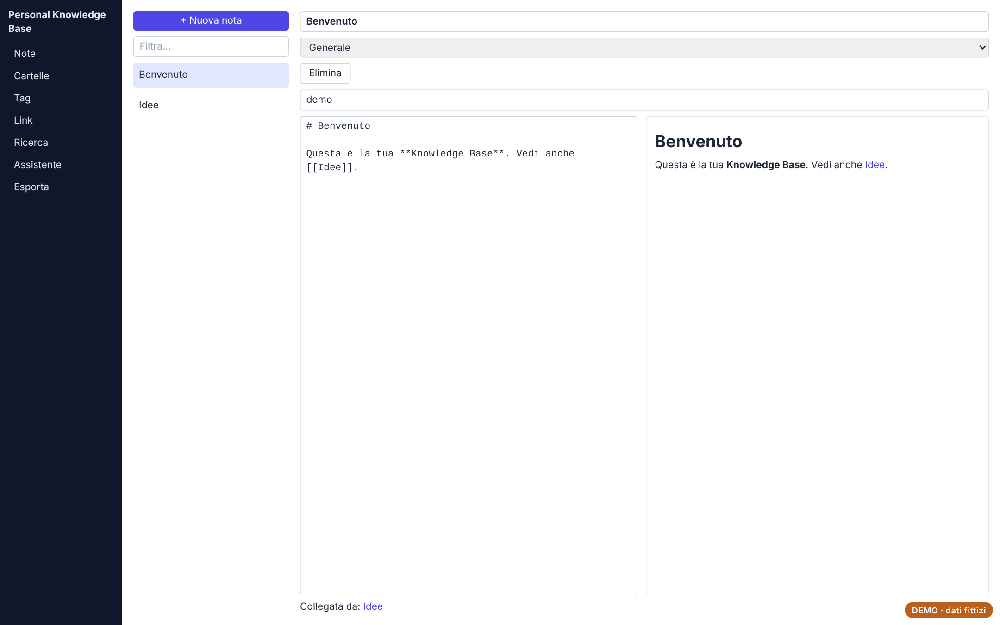
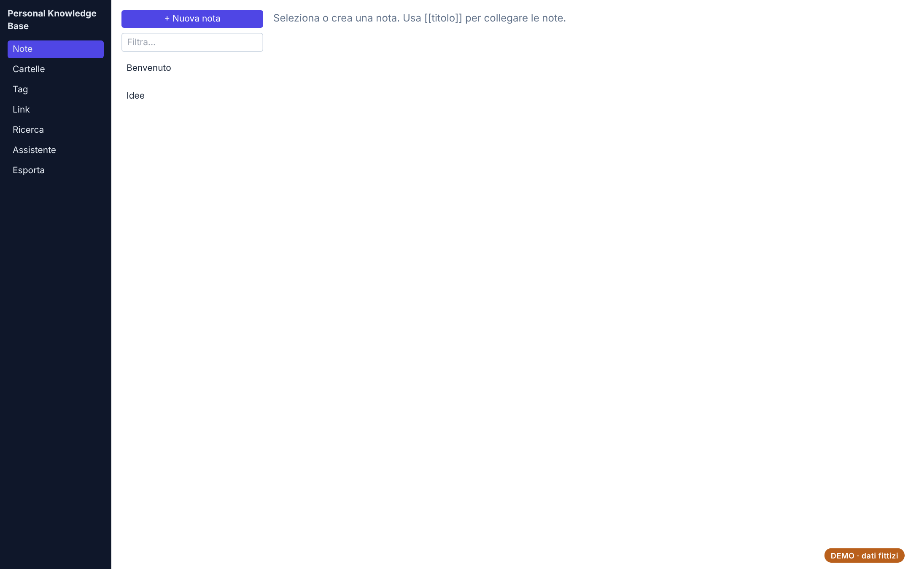
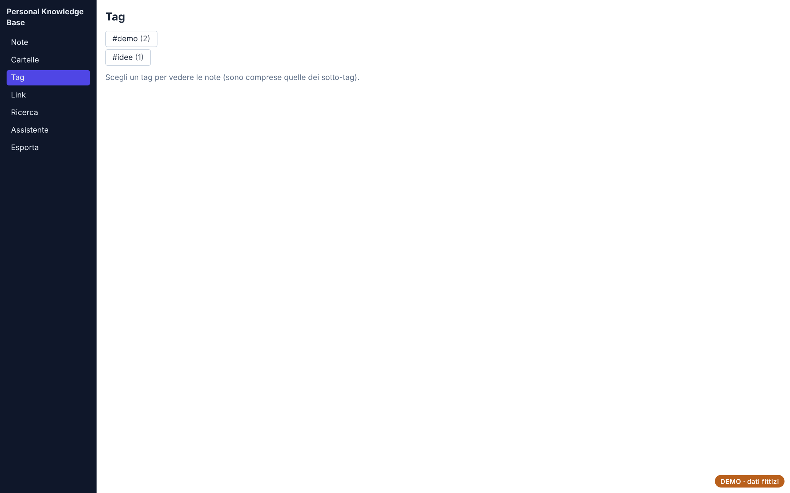
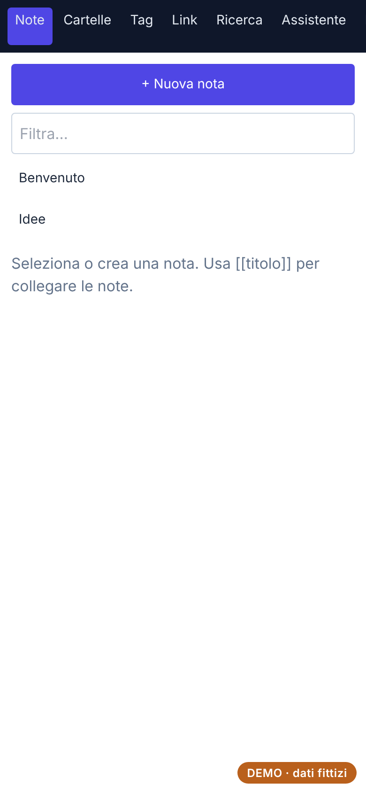

# Personal Knowledge Base

Archivio personale di note in Markdown collegate tra loro, con cartelle, tag, link salvati e un assistente che risponde usando le note.

**[Prova la demo](https://andreapollastrelli95.github.io/personal-knowledge-base-demo/)** · dati fittizi, salvati solo nel tuo browser; nella demo l'assistente AI è disattivato.



## Cosa fa

- **Note in Markdown** con collegamenti `[[titolo]]` tra una nota e l'altra.
- **Cartelle annidate** e **tag gerarchici** (es. `lavoro/progetti`: il tag madre comprende i figli).
- **Ricerca per pertinenza** (titolo, tag, testo) senza distinzione di accenti, con anteprima ed evidenziazione.
- **Link** salvati con note, **Assistente** sulle proprie note (Google Gemini), **esportazione/importazione** JSON.

| Elenco note | Tag | Telefono |
|---|---|---|
|  |  |  |

## Come è fatto

React, TypeScript, Vite, Tailwind CSS, Dexie (IndexedDB), React Router; server Node per la sincronizzazione; Electron per la versione desktop.

I dati vivono nel browser (IndexedDB) e vengono sincronizzati con un archivio centrale tramite `/api/data`, con controllo di versione per non sovrascrivere le modifiche fatte da un altro dispositivo. Nella demo `public/demo-api.js` sostituisce il server con un archivio locale che segue le stesse regole.

## Avviarlo in locale

```bash
npm install
npm run dev      # sviluppo
npm run build    # versione web in dist/
```

---

Progetto di [Andrea Pollastrelli](https://andreapollastrelli95.github.io/).
